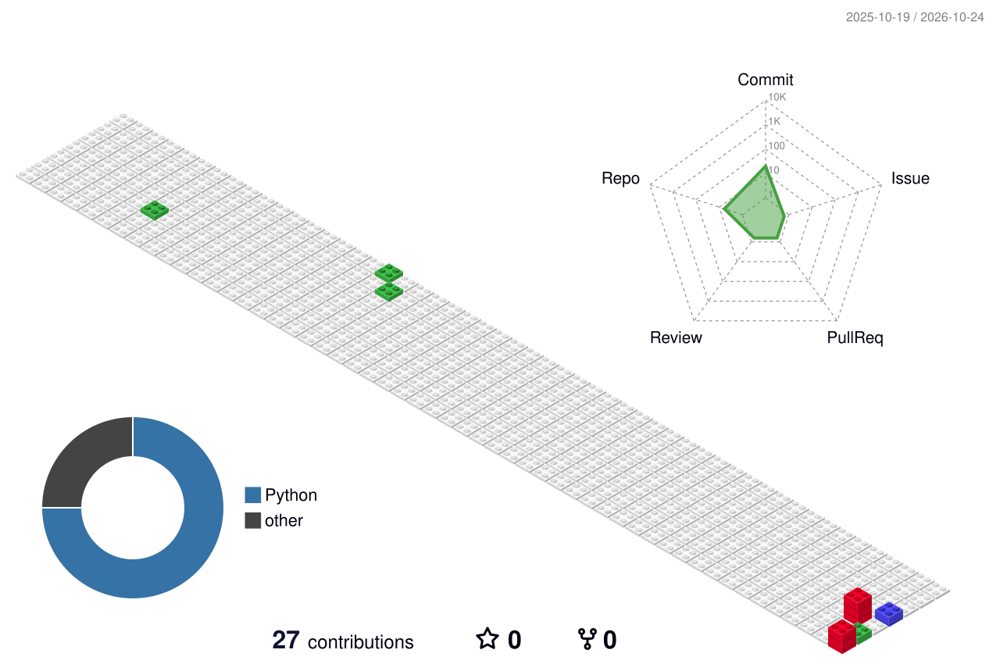

  <!-- 打字动画：修改 lines= 后的文字，多句用 ; 分隔 -->
  [;%E6%AC%A2%E8%BF%8E%E6%9D%A5%E5%88%B0%E6%88%91%E7%9A%84%E4%B8%BB%E9%A1%B5!)](https://git.io/typing-svg)

  <!-- 社交徽章：不需要的整行删掉 -->
  

    &emsp;
    &emsp;
    &emsp;
    
  

   

  <!-- 贪吃蛇贡献图（由 snake.yml 每天生成） -->
  <picture>
    <source media="(prefers-color-scheme: dark)" srcset="./profile-snake-contrib/github-contribution-grid-snake-dark.svg" />
    <source media="(prefers-color-scheme: light)" srcset="./profile-snake-contrib/github-contribution-grid-snake.svg" />
    
  </picture>

## 🙋 About Me

嗨，你好，我是Raylxxx。热爱编程、fps游戏爱好者。

热爱数据科学和 vibe-coding，希望能成为一名优秀的开发者。

我们正在让这个世界变得更加美好，通过代码的重复使用和延展构建完美体系

We're making the world a better place. Through constructing elegant hierarchies for maximum code reuse and extensibility**

## 🛠️ Tech Stack

  <!-- 图标列表见 https://skillicons.dev ，用逗号分隔 -->
  

## 📊 GitHub Stats

  <!-- 连续提交天数 -->
  <picture>
    <source media="(prefers-color-scheme: dark)" srcset="https://github-readme-streak-stats.herokuapp.com/?user=YOUR_USERNAME&theme=dark&hide_border=true" />
    <source media="(prefers-color-scheme: light)" srcset="https://github-readme-streak-stats.herokuapp.com/?user=YOUR_USERNAME&theme=default&hide_border=true" />
    
  </picture>

  <!-- 常用语言 -->
  <picture>
    <source media="(prefers-color-scheme: dark)" srcset="https://github-readme-stats.vercel.app/api/top-langs/?username=YOUR_USERNAME&layout=compact&theme=dark&hide_border=true" />
    <source media="(prefers-color-scheme: light)" srcset="https://github-readme-stats.vercel.app/api/top-langs/?username=YOUR_USERNAME&layout=compact&theme=default&hide_border=true" />
    
  </picture>

  <!-- 3D 贡献图（由 contrib.yml 每天生成） -->
  <picture>
    <source media="(prefers-color-scheme: dark)" srcset="./profile-3d-contrib/profile-night-rainbow.svg" />
    <source media="(prefers-color-scheme: light)" srcset="./profile-3d-contrib/profile-gitblock.svg" />
    
  </picture>

